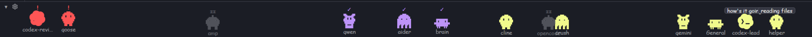

# HERDR-PETS

[](LICENSE)
[](https://herdr.dev/mods/)
[](https://herdr.dev/)
[](https://github.com/Aryan1092raj/Herdr-pets/actions/workflows/ci.yml)


HERDR-PETS is a mod for the Herdr desktop app (herdr-app). Every running coding agent gets a small pixel pet in a strip at the bottom of the window. The pets roam, bounce, sleep and chat, so you can tell at a glance which agents are blocked, working, finished or idle.


## The pets

Claude Code and Codex agents get their own sprite. Every other agent (cline, opencode, aider, gemini and so on) gets one of four creatures, picked from its terminal address, so it keeps the same one for its whole life. In the app each pet is tinted by its status or by the color you pick in settings.

|  |  |  |  |  |  |
| :---: | :---: | :---: | :---: | :---: | :---: |
| **claude-code** | **codex-openai** | **blob** | **cat** | **ghost** | **bot** |
| Claude Code | Codex | any other agent | any other agent | any other agent | any other agent |


How it Looks in App:

## What the pets do

| Status | Pet |
| --- | --- |
| `blocked` | runs to the front (left end) of the strip, bounces fast and shows **!** |
| `done` | roams while it hops and shows **✓** (the app turns done into idle once you look at the agent) |
| `working` | roams the whole strip, picking a new spot every 3 seconds |
| `idle` | shuts its eyes, breathes with `zzz` and drifts a little each beat |

Awake pets blink now and then.

### Agents that start agents

Agents started by another agent through herdr-core (`hc run`, for example a codex or cline helper) get their own pet, labelled with its hc name and linked to the agent that started it. A working helper walks over to its parent and the two chat in speech bubbles for a few seconds. The parent asks things like "need anything?", and the helper answers from its real status, such as "on it…". Then the helper wanders off and comes back. A blocked helper runs to its parent and says "stuck, help?", and the parent answers "on my way". A finished helper reports "done ✓", and the parent says "nice!". An agent's internal subagents are not hc terminals, so they don't appear.

## Play with them

| Do this | What happens |
| --- | --- |
| Click a pet | it bounces and shows hearts |
| Double-click a pet | focuses its agent |
| Drag a pet | picks it up and moves it; it stays put for a moment after you drop it |
| Flick and let go | throws it, and it glides to a stop |
| Hover a pet | tooltip with its name and status |
| `▾` / `▴` at the left end | folds the strip to a thin bar, and opens it again |
| `⚙` next to the arrow | opens the settings |

The settings dialog has two choices, and they are kept across restarts:

- **Show pets**: on or off. Off folds the strip away.
- **Color**: by status (the default), or one of your theme's accent and ANSI colors for all pets.

Each pet is labelled with its space name, or with its hc name when it has no pane. If more agents run than fit in the strip, blocked ones are kept first.

## Install

Requirements: Herdr app (herdr-app) 0.1.10 or later.

Option A: tell the agent in your Herdr app `Read ~/.config/herdr-app/AGENTS.md, then add this mod: https://github.com/Aryan1092raj/Herdr-pets`. It reads every file, copies `mods/herdr-pets/` into place, and rebuilds from [RECIPE.md](RECIPE.md) only if the files don't work on your version.

Option B, manual:

```sh
git clone https://github.com/Aryan1092raj/Herdr-pets.git
cp -r Herdr-pets/mods/herdr-pets ~/.config/herdr-app/mods/
herdr-app check ~/.config/herdr-app/mods/herdr-pets
```

The first time the app sees the folder, it docks the strip at the bottom of the current layout, 64 px tall. If the name `herdr-pets` is already taken, rename the folder and change the `MOD` constant at the top of `main.js` to match, because sprite paths use it.

To remove it, delete `~/.config/herdr-app/mods/herdr-pets`.

## What it reads

HERDR-PETS reads the app's live agent and terminal lists (`agents()` and `terminals()` from the `herdr` module, which include each terminal's parent and status report). It runs no programs, reads no files outside its folder, and makes no network requests. Its only actions are `agent.focus` when you double-click a pet and `layout.resize` on its own strip when you fold it. Your settings are stored with the app's `setShared`.

## Develop

Run the logic tests with Node 18 or later, and check the mod with herdr-app:

```sh
node --test test/pets.test.mjs
herdr-app check mods/herdr-pets
```

The mod lives in `mods/herdr-pets/`:

- `main.js` draws the strip, the pets and the settings dialog, and handles the mouse.
- `pets.js` holds placement, roaming, dialogue and throw logic, with no app imports.
- `*.svg` are the six sprites and the settings gear. `docs/sprites/` holds tinted copies for this README.
- `mod.json` docks the strip at the bottom, 64 px tall.

See [CONTRIBUTING.md](CONTRIBUTING.md) and the [code of conduct](CODE_OF_CONDUCT.md).

## License

HERDR-PETS is released under the [MIT License](LICENSE). Copyright (c) 2026 Aryan Raj.
