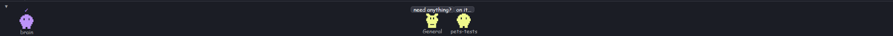

# herdr-pets

A strip along the bottom of the window where every running agent is a small pixel creature that roams the whole row. Color and motion show each agent's status, so a blocked agent is easy to spot without reading the sidebar. Helpers that an agent starts through herdr-core walk over to their parent and chat in speech bubbles. Clicking a pet focuses its agent. A small arrow folds the strip away.

## What you see

One block, 64 px tall, docked at the bottom of the layout and filled with the theme's `chrome` color. A `▾` arrow sits at its top-left corner (14 × 16 px, 4 px in, `muted`), and pets keep 20 px clear of the left edge so it stays clickable.

Pets stand on the strip's bottom edge, one per agent, anywhere along the row. A pet is 56 px wide and has three rows:

- a 12 px badge row, which shows a speech bubble while it chats;
- a 28 × 28 px creature, drawn from a one-color 16 × 16 pixel SVG and tinted with the theme's color for its status (`working`, `blocked`, `done` or `idle`);
- a 12 px label in `muted`, truncated: the agent's space name, or its hc name when it has no pane.

With no agents, the strip shows "No agents yet" in `dim`, centered.

There are four creatures: `blob`, `cat`, `ghost` and `bot`. Each agent's creature, and its first spot, come from an FNV-1a hash of its terminal address, so it keeps the same ones for its whole life. A speech bubble is a `popover`-colored pill with a 1 px `border`, holding one line of `text_xs` text in `foreground`, centered over the pet and 44 px wider than it.

## How it behaves

- A 3 s timer is the beat. Each beat, working pets pick a new random spot and slide there linearly for 3 s, so they keep walking. That timer is the only one in the mod, and it redraws once per beat.
- **blocked:** a blocked pet without a parent slides to the front in 700 ms with ease-out, lined up from the left in address order. It bounces 8 px every 500 ms, and its badge is a bold **!** in `blocked`.
- **done:** stays where it is, hops 5 px every 1100 ms, and shows **✓** in `done`. The app turns done into idle once the person looks at the agent.
- **working:** roams as above and bobs 2 px every 400 ms. No badge.
- **idle:** stays where it is. Its opacity breathes between 0.5 and 0.8 every 3.2 s, and its badge cycles `z`, `zz`, `zzz` every 700 ms in `dim`.
- **Children** are terminals whose hc `parent` is another shown agent, such as a codex helper started with `hc run`. A working child cycles through three beats: it walks to stand beside its parent (one slot to the right, or to the left at the right edge), then they chat, then it wanders to a random spot. The parent holds still during the first two beats. While they chat:
  - the parent asks one of "how's it going?", "need anything?", "status?" or "all good?";
  - the child answers one of "on it…", "almost there", "reading files" or "running tests".

  A blocked child stands beside its parent saying "stuck, help?", and the parent says "on my way". A done child says "done ✓", and the parent says "nice!". Lines rotate with the beat.
- Only as many pets as fit `(width − 20) / 56` are drawn, at least one, blocked first, then done, working and idle.
- Hovering a pet gives it the `hover` background and a tooltip, `<label>: <status>`. Clicking it runs `agent.focus {terminal}`.
- Clicking `▾` runs `layout.resize {id, px: 18}` on the strip's own node, found in `layout()` by `content.mod`. The strip then shows only `▴`, and clicking `▴` resizes back to 64. The strip counts as collapsed when its height is under 32 px, so the state survives reloads.

## Built from

- `mod.json`: `{ "place": "bottom", "size": 64, "title": "Pets" }`.
- `pets.js` has no imports:
  - `collect(terminals, agents)` keeps live terminals with a status. It labels each from `agents()` (`space_name`, then `tab_name`), else from the hc `name`, then `agent`. It keeps `parent` only when the parent is also shown.
  - `place(list, prev, width, tick, roam, rand)` returns `{address, status, label, parent, kind, seed, x, meet, say}`. It places parents before children at any depth, keeps the previous `x` unless `roam`, and clamps to `[20, width − 56]`.
  - `node --test test/pets.test.mjs` covers both (14 tests).
- `main.js` reads `agents()`, `terminals()`, `theme()`, `settings()` and `layout()` from `herdr`. The size comes from `on_size_change` on the root `div`, divided by `settings().zoom`. Each pet has two layers:
  - an absolute `v_flex` slot, `justify_end`, with `left(x)` and `transition("left")` (3 s linear, or 700 ms ease-out when blocked), which handles walking and running;
  - a `relative` body with `loop("top")` or `loop("opacity")`, which handles bouncing and breathing.

  The idle badge uses `frames`.
- Art: `blob.svg`, `cat.svg`, `ghost.svg` and `bot.svg`. They are original 16 × 16 silhouettes made of `<rect fill="currentColor">` with transparent eye holes, drawn with `svg()`.
- It runs no programs, reads no files, and makes no network requests.

## Watch out

- `line_height(12)` is a 12× multiplier, not 12 px. Use `line_height("12px")`.
- In herdr-app 0.1.10, `on_size_change` reports sizes before the app's zoom while layout lengths are zoomed. Divide by `settings().zoom`, or pets drift right and get cut off.
- The first render happens before any size report. Don't remember spots computed at width 0, or every pet that doesn't walk stays stuck at the left edge.
- Remembered spots must survive redraws for data changes. Only the beat may move working pets, or every status change makes them jump.
- Pets anchor to the bottom with `justify_end`, and the bounce is a `relative` `top` offset from 0.
- `agents()` lists only terminals in panes. Helpers started with `hc run --bg` show up only in `terminals()`.
- An agent's own internal subagents aren't hc terminals and never appear.
- SVG paths are `mods/herdr-pets/<kind>.svg`, relative to the app home. If the folder is renamed, change `MOD` in `main.js`.

## Done when

- `herdr-app check ~/.config/herdr-app/mods/herdr-pets` passes, and `herdr-app status` shows no errors.
- `node --test test/pets.test.mjs` passes 14 of 14.
- With an agent running and a helper started from it via `hc run --bg`, shots taken over about 10 s show these steps in order: the helper walks to its parent, then both show bubbles side by side, then the helper walks away.
- When an agent becomes blocked, its pet slides to the front, bounces, and shows **!**. Clicking a pet focuses that agent.
- `layout.resize` to 18 leaves only `▴`. Resizing to 64 brings the pets back where they were.
